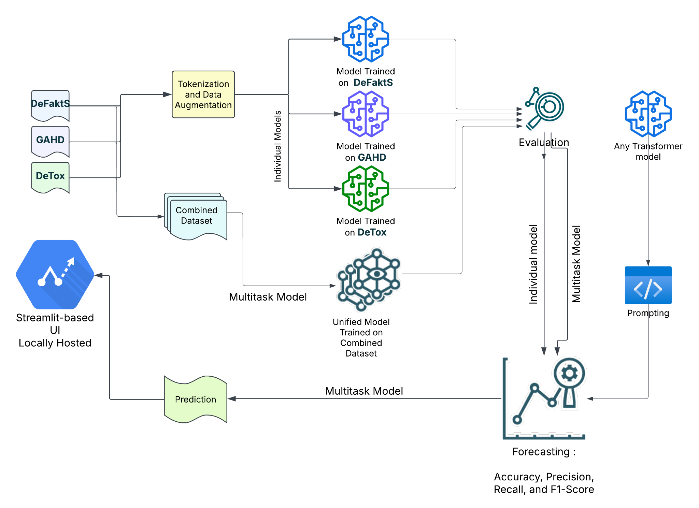
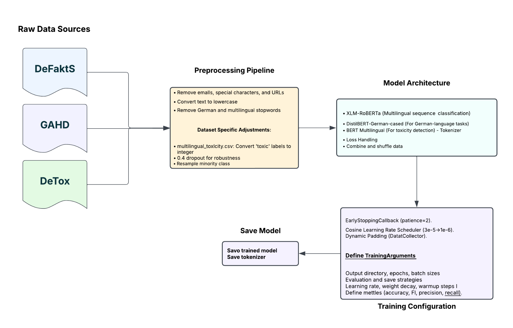
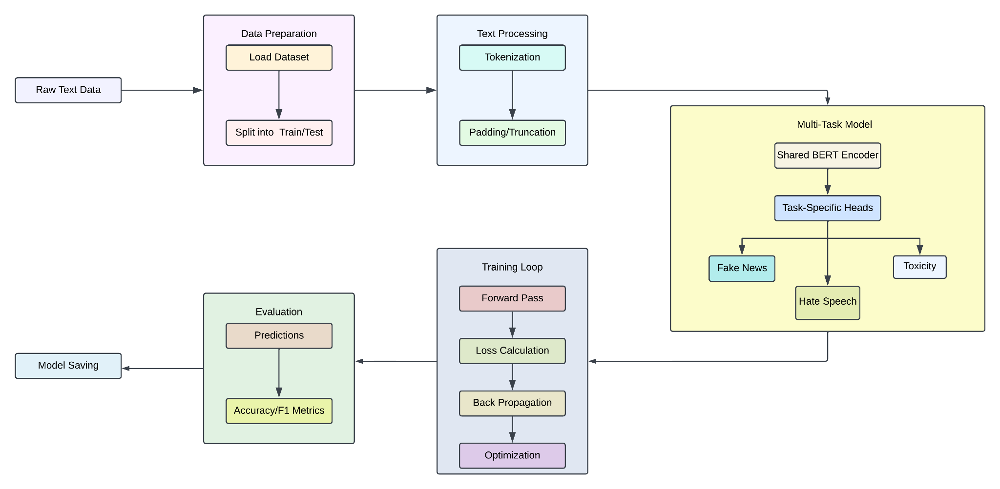

<div align="center">

# 🛡️ German Harmful Content Detection

### Fake News · Hate Speech · Toxicity in German Social Media

**Single-task transformers vs. a unified multi-task BERT vs. T5 vs. LLM prompting, compared on three German benchmarks with explainability (SHAP) and leakage-safe evaluation**


[Overview](#-overview) · [Datasets](#-datasets) · [Architecture](#-architecture) · [Results](#-results) · [Findings](#-key-findings) · [Quickstart](#-quickstart) · [📄 Review paper](docs/review_paper.pdf)

</div>

---

## 📌 Overview

Disinformation, hate speech and toxicity rarely appear alone. A false claim about a minority comes wrapped in hateful framing and draws toxic replies. Moderation systems, however, usually run a separate model for each harm.

This project builds and compares **four modelling paradigms** for detecting all three harms in **German** social media text:

| # | Paradigm | Models | Idea |
|---|---|---|---|
| 1 | **Single-task fine-tuning** | DistilBERT-German · XLM-RoBERTa · mBERT | one specialist encoder per harm |
| 2 | **Unified multi-task BERT** | bert-base-german-cased + 3 heads | one shared encoder, masked multi-task loss |
| 3 | **Unified text-to-text** | T5 / mT5 | all tasks as generation |
| 4 | **LLM prompting** | Llama 3.1 / 3.3, Mistral, Phi-4, GPT-4o-mini | zero- and few-shot, no training |

**Research questions**

> **RQ1.** Do separate models per task outperform one unified multi-task model?
> **RQ2.** What does combined detection teach us about healthier online discourse?
> **RQ3.** How do encoder, encoder-decoder and decoder-only (LLM) architectures compare?

📄 The full study is written up as an 8-page review paper: [**PDF**](docs/review_paper.pdf) · [Markdown](docs/review_paper.md) · [Word](docs/review_paper.docx)

---

## 🗂 Datasets

All three corpora are **German**. Details and download instructions: [`data/README.md`](data/README.md).

| | Task | Dataset | Size | Class balance | What makes it hard |
|---|---|---|---|---|---|
| 📰 | **Fake news / disinformation** | [DeFaktS](https://aclanthology.org/2024.lrec-main.409/): German tweets annotated for disinformation *framing* | 5,000 | 50 / 50 | labels a framing *style*, not factual falsity |
| 🚫 | **Hate speech** | [GAHD](https://aclanthology.org/2024.naacl-long.248): German Adversarial Hate speech Dataset | 10,996 | 58 / 42 | adversarially written, often *implicit* hate |
| ☣️ | **Toxicity** | DeTox + GermEval 2018 / 2021 comments | 5,000 | 50 / 50 | rudeness vs. heated but legitimate debate |
| 🔗 | **Unified** | all three merged; each row labelled for one task, `-1` elsewhere | 15,000 | 5,000 per task | partially labelled multi-task data |

<details>
<summary><b>Example posts</b></summary>

| Task | Example (from the data) | Label |
|---|---|---|
| Fake news | *„Bekämpfung der Erderwärmung: G7-Staaten gründen ‚Klimaclub‘ …“* | neutral |
| Hate speech | *„Ich mag Sterne. Morgensterne, Abendsterne, Filmsternchen … Nur Judensterne nicht“* | hate (implicit) |
| Hate speech | *„Ich liebe Inder“* | not hate |
| Toxicity | *„Was ist nur mit diesem Scheißland passiert? Alle werden kollektiv bekloppt …“* | toxic |

</details>

---

## 🏗 Architecture

### End-to-end system

<p align="center">
  
</p>

The three German corpora (**DeFaktS**, **GAHD**, **DeTox**) go through tokenization and data preparation. From there, three paths are trained and evaluated side by side:

- **Individual models:** one transformer per dataset.
- **Unified multi-task model:** trained on the combined dataset.
- **Prompting:** any transformer LLM, no training needed.

All paths are scored with the same metrics (accuracy, precision, recall, F1). In the system design, the multi-task model's predictions are shown in a locally hosted **Streamlit** UI.

### Individual (single-task) models

<p align="center">
  
</p>

### Unified multi-task model

<p align="center">
  
</p>

---

## 📊 Results

Accuracy and F1 on held-out test data from the study (see the [paper](docs/review_paper.pdf) for precision and recall):

| Paradigm | Model | 📰 Fake news | 🚫 Hate speech | ☣️ Toxicity | Avg. acc. |
|---|---|---|---|---|---|
| ① **Single-task** | DistilBERT-de / XLM-R / mBERT | **91.0%** · F1 91 | 78.1% · F1 77.9 | 88.7% · F1 88.7 | **85.9%** |
| ② **Unified multi-task** | bert-base-german-cased, 3 heads | 85.0% | 76.0% · F1 74 | **91.0%** · F1 90 | 84.0% |
| ③ Unified text-to-text | t5-base (course version) | 73.0% · F1 51 | 68.0% · F1 42 | 51.0% · F1 40 | 64.0% |
| ④ LLM, few-shot | GPT-4o-mini | 59% | **79%** | 78% | 72.0% |
| ④ LLM, few-shot | Llama-3.3-70B (Q6) | 60% | 72% | 77% | 69.7% |
| ④ LLM, zero-shot | GPT-4o-mini | 40% | 46% | 46% | 44.0% |

<details>
<summary><b>All LLM results (accuracy)</b></summary>

| Model | Fake news | Hate speech | Toxicity |
|---|---|---|---|
| llama3.1:8b-instruct-q6_K | 51% | 57% | 58% |
| llama3.3:70b-instruct-q6_K | 60% | 72% | 77% |
| mistral:7b-instruct-v0.2-q6_K | 57% | 64% | 70% |
| phi4 (14B) | 58% | 71% | 68% |
| gpt-4o-mini, zero-shot | 40% | 46% | 46% |
| gpt-4o-mini, few-shot | 59% | 79% | 78% |

</details>

```text
Best accuracy per task
📰 Fake news    ① Single-task  ███████████████████████████████████████████▋ 91.0
                ② Multi-task   ████████████████████████████████████████▊    85.0
                ④ LLM          ████████████████████████████▋                60.0
🚫 Hate speech  ① Single-task  █████████████████████████████████████▍       78.1
                ② Multi-task   ████████████████████████████████████▍        76.0
                ④ LLM          █████████████████████████████████████▉       79.0
☣️ Toxicity     ① Single-task  ██████████████████████████████████████████▌  88.7
                ② Multi-task   ███████████████████████████████████████████▋ 91.0
                ④ LLM          █████████████████████████████████████▍       78.0
```

---

## 🔍 Key findings

| | Finding | Evidence |
|---|---|---|
| 🏆 | **No single winner.** Specialists win fake news, the unified model wins toxicity, and few-shot LLMs win (narrowly) hate speech. | Results table |
| 📰 | **Fake news needs a specialist.** The unified model loses 6 points: disinformation cues (framing, sensationalism, missing sources) differ from abuse cues, so a shared encoder dilutes them (*task interference*). | ① 91% vs. ② 85% |
| ☣️ | **Toxicity benefits from sharing.** Toxicity and hate speech share surface features (insults, slurs), so multi-task training transfers positively, with **one encoder instead of three**. | ② 91% vs. ① 88.7% |
| 🚫 | **Hate speech is the hardest task for fine-tuned models.** GAHD is adversarial, and much of its hate is implicit (*„Nur Judensterne nicht“*). LLMs with world knowledge match the encoders here. | best 78–79% |
| 🤖 | **LLMs need demonstrations.** A few German examples add 19–33 points to GPT-4o-mini. LLMs still trail encoders by about 31 points on fake news, because DeFaktS's "disinformation" is an annotation-defined framing style, not a general concept. | Zero- vs. few-shot |
| 🔬 | **SHAP shows shortcut learning.** The fake-news model keys on framing words (*„trigger“*, *„liberal“*); the toxicity model keys on the *topic* word *„Querdenker“* more than on the insult *„Scheiß“*. Models learn dataset-specific cues, not the harm itself. | SHAP notebooks 04–07 |
| 🧪 | **Adversarial probing exposes failure modes.** The unified model misses calm conspiracy claims (*„Die Erde ist tatsächlich flach…“*) and flags hostile political statements as fake. | Paper §5.4 |

### ⚠️ Methodological lessons, fixed in this repo

| Pitfall in the original experiments | Effect | Fix here |
|---|---|---|
| Minority-class oversampling **before** the train/test split (fake news, hate speech) | duplicated posts in train **and** test → inflated scores | split first; balance **train only**; exact-duplicate removal |
| Test set used for early stopping / checkpoint selection (all single-task models) | optimistic test scores | separate validation split; test evaluated once |
| Aggressive cleaning for GAHD (lowercasing; deleting digits, punctuation and emojis) | removes signals such as 🤥 sarcasm or capitalised nouns | light, case- and emoji-preserving cleaning for all tasks |
| T5 trained to *generate* `-1` for missing labels; padding counted in the loss; LR schedule for 7 epochs, training for 4 | T5 collapsed (toxicity F1 40) | task-prefixed examples only for labelled tasks; `-100` label padding; schedule matches epochs; multilingual **mT5** |
| Unparseable LLM answers mapped to class 0 | hidden format failures, biased accuracy | invalid answers counted and reported separately |
| Hard-coded paths/GPU ids, inconsistent column names, API-key slot in code | not reproducible | YAML configs, one schema, key from environment, resumable JSONL cache |

---

## 🚀 Quickstart

```bash
git clone https://github.com/farhanaliarshad1/german-harmful-content-detection.git
cd german-harmful-content-detection
python -m venv .venv && source .venv/bin/activate      # Windows: .venv\Scripts\activate
pip install -e ".[llm,explain,dev]"
```

Put the CSVs in `data/` (see [`data/README.md`](data/README.md)), then:

```bash
# ① Single-task models: one config per harm (GPU used automatically)
python -m harmdetect.train --config configs/fake_news_distilbert.yaml
python -m harmdetect.train --config configs/hate_speech_xlmr.yaml
python -m harmdetect.train --config configs/toxicity_mbert.yaml
#    any value can be overridden from the CLI
python -m harmdetect.train --config configs/fake_news_distilbert.yaml --model_name deepset/gbert-base --balance oversample

# ② Unified multi-task BERT (all three tasks, masked loss)
python -m harmdetect.multitask --data data/merged_dataset.csv --epochs 3

# ③ Unified task-prefixed mT5
python -m harmdetect.t5_unified --data data/merged_dataset.csv --model_name google/mt5-small

# ④ LLM baseline: OpenAI, or any OpenAI-compatible server such as Ollama
export OPENAI_API_KEY=...
python -m harmdetect.llm_baseline --model gpt-4o-mini --few_shot --n 600
python -m harmdetect.llm_baseline --model llama3.1:8b --base_url http://localhost:11434/v1 --few_shot

# Predict & explain
python -m harmdetect.predict --model outputs/hate_speech-xlmr/model --text "Diese Minderheit zerstört unser Land."
python -m harmdetect.explain --model outputs/toxicity-mbert/model --data outputs/toxicity-mbert/test_predictions.csv

# Tests
pytest -q
```

Every run writes `metrics.json` (config, split sizes, test metrics, confusion matrix, per-class report), `test_predictions.csv` and the model to `outputs/<run>/`.

---

## 🧭 Future work

- Re-run all single-task models with the leakage-safe pipeline and report mean ± std over seeds.
- Predict DeFaktS's **fine-grained framing indicators** (polarisation, vagueness, missing sources) instead of a binary label.
- Reduce task interference with adapters, loss re-weighting or gradient surgery.
- LoRA-fine-tune an open LLM on the merged corpus, and add functional tests in the style of HateCheck for German.

## 🙏 Acknowledgements

Developed as a **Research Case Study** in the M.Sc. Natural Language Processing programme at **Universität Trier** (TWON Metrics, WS 2024/25), together with fellow students Aastha Shreya, Shivang Sinha, Syed Huzaifa Ali, Donya Sheikhi and Muhammad Ahmed. Open-model inference used the university's LLM service.

## 📚 References

- Ashraf et al. (2024). *DeFaktS: A German Dataset for Fine-Grained Disinformation Detection through Social Media Framing.* LREC-COLING.
- Goldzycher, Röttger & Schneider (2024). *Improving Adversarial Data Collection by Supporting Annotators: Lessons from GAHD, a German Hate Speech Dataset.* NAACL.
- Wiegand, Siegel & Ruppenhofer (2018). *Overview of the GermEval 2018 Shared Task on the Identification of Offensive Language.*
- Risch, Stoll, Wilms & Wiegand (2021). *Overview of the GermEval 2021 Shared Task on the Identification of Toxic, Engaging, and Fact-Claiming Comments.*
- Devlin et al. (2019) *BERT* · Conneau et al. (2020) *XLM-R* · Raffel et al. (2020) *T5* · Lundberg & Lee (2017) *SHAP*

Full bibliography: [review paper](docs/review_paper.md#references).

## 📄 License

Code: [MIT](LICENSE). Datasets keep their original licences and are **not** redistributed.
