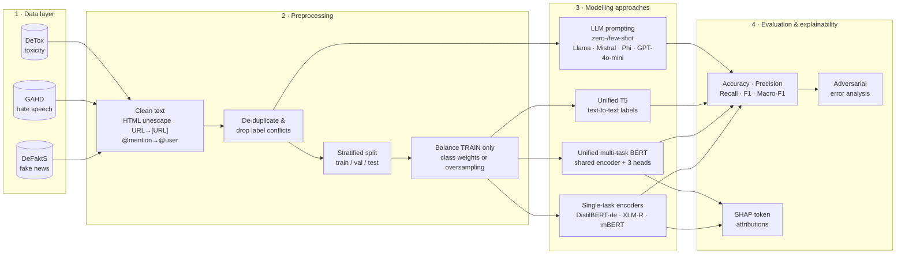
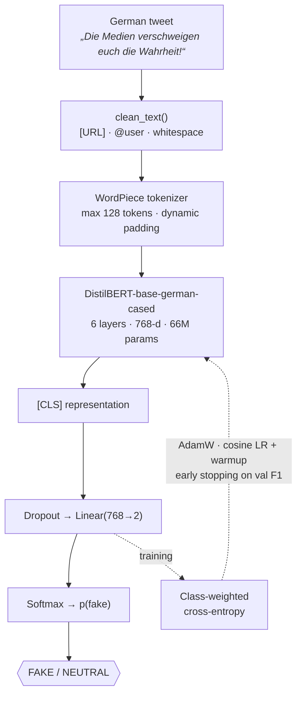
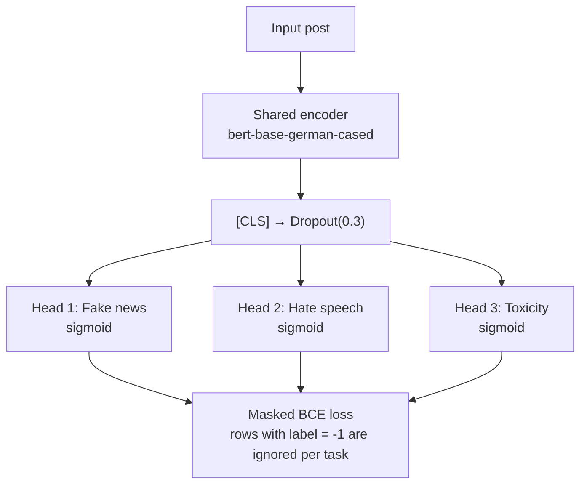

<div align="center">

# 🛡️ German Harmful Content Detection

### Fake News · Hate Speech · Toxicity in German Social Media

**Single-task transformers vs. a unified multi-task BERT vs. LLM prompting, with a focus on fake-news (disinformation) detection on DeFaktS**


[Overview](#-overview) · [Architecture](#-architecture) · [Results](#-results) · [Quickstart](#-quickstart) · [Review paper](docs/review_paper.md) · [My role](#-my-role)

</div>

---

## 📌 Overview

Disinformation, hate speech and toxicity rarely appear alone. A false claim about a minority often comes wrapped in hateful framing and draws toxic replies. Moderation systems, however, usually treat each problem with its own model.

This project, a **Research Case Study at Universität Trier (TWON Metrics, Group B1, WS 2024/25)**, asks:

> **RQ1.** Do separate transformer models trained per task outperform one unified multi-task model trained on all three tasks?
> **RQ2.** What does combined detection teach us about building safer, more trustworthy social media?
> **RQ3.** How do encoder (BERT), encoder-decoder (T5) and decoder-only LLMs (Llama, Mistral, Phi, GPT-4o-mini) compare on these tasks?

All data is **German-language social media text**.

| Task | Dataset | Size | Labels |
|---|---|---|---|
| 📰 **Fake news / disinformation** | [DeFaktS](https://aclanthology.org/2024.lrec-main.409/) (Ashraf et al., 2024): German tweets | 5,000 (balanced subset) | fake / neutral |
| 🚫 Hate speech | [GAHD](https://aclanthology.org/2024.naacl-long.248) (Goldzycher et al., 2024): adversarial German hate speech | ~11,000 | hate / not hate |
| ☣️ Toxicity | DeTox / GermEval 2018 & 2021 | 5,000 (balanced) | toxic / non-toxic |
| 🔗 Unified | All three merged; each row labelled for one task, `-1` elsewhere | 15,000 | 3 × binary |

---

## 🏗 Architecture

### End-to-end system



### Fake-news classifier (single-task)



### Unified multi-task model



---

## 📊 Results

Results from the course project (held-out test splits, reported in the final presentation, March 2025):

| Approach | Model | 📰 Fake news | 🚫 Hate speech | ☣️ Toxicity |
|---|---|---|---|---|
| **Single-task** | DistilBERT-german / XLM-R / mBERT | **91.0%** acc · 91% F1 | 78.1% acc · 77% F1 | 88.0% acc · 88% F1 |
| **Unified multi-task** | bert-base-german-cased, 3 heads | 85.0% acc | 76.0% acc · 74% F1 | **91.0%** acc · 90% F1 |
| Unified text-to-text | t5-base | 73% acc · 51% F1 | 68% acc · 42% F1 | 51% acc · 40% F1 |
| LLM, few-shot | GPT-4o-mini | 59% acc | **79%** acc | 78% acc |
| LLM, zero-shot | GPT-4o-mini | 40% acc | 46% acc | 46% acc |
| LLM, few-shot | Llama-3.3-70B (Q6) | 60% acc | 72% acc | 77% acc |

<details>
<summary><b>All LLM prompting results (accuracy)</b></summary>

| Model | Fake news | Hate speech | Toxicity |
|---|---|---|---|
| llama3.1:8b-instruct-q6_K | 51% | 57% | 58% |
| llama3.3:70b-instruct-q6_K | 60% | 72% | 77% |
| mistral:7b-instruct-v0.2-q6_K | 57% | 64% | 70% |
| phi4 | 58% | 71% | 68% |
| gpt-4o-mini, zero-shot | 40% | 46% | 46% |
| gpt-4o-mini, few-shot | 59% | 79% | 78% |

</details>

### Key findings

1. **Specialists win on fake news.** The single-task DistilBERT beats the unified model by about 6 points. Disinformation cues (framing, sensationalism, missing sources) differ from abuse cues, and a shared encoder dilutes them (*task interference*).
2. **Multi-task helps toxicity.** The unified model gains about 3 points on toxicity, which shares surface features with hate speech (positive transfer). One encoder serves three tasks, about **⅓ of the inference cost**.
3. **Fine-tuned encoders beat prompted LLMs on fake news by a wide margin** (91% vs. ≤60%). DeFaktS labels a *style of framing*, which a model learns from labelled examples but an LLM following a generic definition does not.
4. **Few-shot examples matter enormously for LLMs.** GPT-4o-mini gains +19 to +33 points from four demonstrations.
5. **The fake-news model learns framing, not factuality.** SHAP highlights words like *„trigger“* and *„liberal“*. Error analysis shows it misses calm, factual-sounding conspiracy claims (*„Die Erde ist tatsächlich flach…“*) and over-flags hostile political statements.
6. **T5 underperformed for engineering reasons, not architectural ones.** These are fixed and documented in the [review paper](docs/review_paper.md#63-methodological-pitfalls-we-found).

> ⚠️ **Reproducibility note.** While re-implementing the fake-news pipeline I found that the original notebook **oversampled before the train/test split**, so copies of the same tweet appeared in both train and test. The 91% figure is therefore likely optimistic. This repository splits first, balances the training split only, de-duplicates, and selects checkpoints on a separate validation set. See [`src/fakenews/data.py`](src/fakenews/data.py) and the [review paper, §6.3](docs/review_paper.md#63-methodological-pitfalls-we-found).

---

## 🚀 Quickstart

```bash
git clone https://github.com/farhanaliarshad1/german-harmful-content-detection.git
cd german-harmful-content-detection
python -m venv .venv && source .venv/bin/activate      # Windows: .venv\Scripts\activate
pip install -e ".[llm,explain,dev]"                      # or: pip install -r requirements.txt
```

Put the data in `data/` (see [`data/README.md`](data/README.md)), then:

```bash
# 1. Fine-tune the fake-news classifier (config-driven, GPU used automatically)
python -m fakenews.train --config configs/distilbert_german.yaml

#    ... try a stronger German encoder or another balancing strategy
python -m fakenews.train --config configs/gbert_base.yaml --balance oversample

# 2. Predict
python -m fakenews.predict --model outputs/distilbert-german-defakts/model \
    --text "Die Medien verschweigen euch die Wahrheit über die Wahl! Teilt das!"

# 3. Explain with SHAP (word-level attributions + HTML plots)
python -m fakenews.explain --model outputs/distilbert-german-defakts/model \
    --data outputs/distilbert-german-defakts/test_predictions.csv --n 200

# 4. LLM baseline: OpenAI or any OpenAI-compatible server (e.g. Ollama)
export OPENAI_API_KEY=...
python -m fakenews.llm_baseline --model gpt-4o-mini --few_shot --n 500
python -m fakenews.llm_baseline --model llama3.1:8b --base_url http://localhost:11434/v1 --few_shot

# 5. Unified multi-task BERT (fake news + hate speech + toxicity)
python -m fakenews.multitask --data data/merged_dataset.csv --epochs 3

# Tests
pytest -q
```

Each training run writes `metrics.json` (config, split sizes, test metrics, confusion matrix, per-class report), `test_predictions.csv` and the saved model to `outputs/<run>/`.

---

## 📁 Project structure

```
german-harmful-content-detection/
├── configs/
│   ├── distilbert_german.yaml   # main fake-news experiment
│   └── gbert_base.yaml          # stronger German encoder
├── src/fakenews/
│   ├── data.py                  # cleaning, de-dup, leakage-safe split, train-only oversampling
│   ├── modeling.py              # dataset, class-weighted Trainer, metrics
│   ├── config.py                # typed YAML config
│   ├── train.py                 # fine-tuning CLI (early stopping on validation F1)
│   ├── predict.py               # inference on text / CSV
│   ├── explain.py               # SHAP word-level attributions
│   ├── prompts.py               # zero-/few-shot German disinformation prompts
│   ├── llm_baseline.py          # async, resumable LLM evaluation
│   └── multitask.py             # shared-encoder BERT, 3 heads, masked BCE
├── tests/                       # pytest: cleaning, leakage, parsing, masked loss
├── notebooks/                   # original course notebooks (DistilBERT + SHAP)
├── docs/
│   ├── review_paper.md          # 📄 6–8 page review paper on the project
│   └── research_proposal.docx   # original research proposal
└── data/README.md               # how to obtain DeFaktS / GAHD / DeTox
```

### What changed vs. the original course code

| Issue in the original code | Fix in this repo |
|---|---|
| Oversampling **before** the split → duplicated tweets in train and test | Split first; oversample/weight **train only**; exact-duplicate removal |
| Test set used for early stopping and checkpoint selection | Separate validation set; test set evaluated once |
| Hard-coded paths and GPU ids (`/home/...`, `CUDA_VISIBLE_DEVICES=3`) | YAML config + CLI overrides; device auto-detected |
| Column names differed between scripts (`isFake` / `is_fake` / `fake_news`) | One schema, validated on load |
| Unparseable LLM answers silently mapped to class 0 | Counted and reported as `invalid_answers` |
| API key slot in source code; no resume on failure | Key read from env; JSONL cache makes runs resumable; retries with backoff |
| T5 trained to *generate* `-1` for missing labels; pad tokens counted in the loss | Multi-task model uses per-task masked loss (see paper §6.3) |
| No tests | `pytest` suite covering cleaning, leakage, label parsing and masked loss |

---

## 👤 My role

**Farhan Ali Arshad**, fake-news track (DeFaktS):

- **Dataset engineering:** cleaned and prepared the German DeFaktS Twitter corpus: label normalisation, URL/mention handling, de-duplication, class balancing, and the balanced 5,000-tweet subset used by the unified model.
- **Fake-news modelling:** worked on the fake-news classifiers (DistilBERT-German, class-weighted loss, early stopping) and their comparison against the unified multi-task BERT and T5.
- **Prompt engineering:** designed the German zero-/few-shot prompts with explicit disinformation criteria used for the LLM benchmark (Llama 3.x, Mistral, Phi-4, GPT-4o-mini).
- **This repository:** re-implemented the pipeline as a tested Python package, found and fixed the train/test leakage, and wrote the [review paper](docs/review_paper.md).
- Presented the mid-term research proposal.

## 🤝 Team & acknowledgements

This was a team project. Original repository: [Aastha031295/TWON_Metrics](https://github.com/Aastha031295/TWON_Metrics).

| Member | Main contributions |
|---|---|
| Aastha Shreya | LLM prompting pipeline (multi-model inference), unified T5 model |
| Shivang Sinha | Unified dataset construction, unified multi-task BERT, GPT-4o-mini prompting |
| **Farhan Ali Arshad** | **Fake-news track: DeFaktS data preparation, fake-news models, prompt design** |
| Syed Huzaifa Ali | Research proposal, individual models, SHAP analysis |
| Donya Sheikhi | Architecture diagram, frontend, final presentation |
| Muhammad Ahmed | Data collection and preprocessing |

Supervised within the **TWON** (*TWin of Online Social Networks*) research context at Universität Trier. LLM inference for open models used the university's inference service.

## 📚 References

- Ashraf, S., Bezzaoui, I., Andone, I., Markowetz, A., Fegert, J., & Flek, L. (2024). *DeFaktS: A German Dataset for Fine-Grained Disinformation Detection through Social Media Framing.* LREC-COLING 2024.
- Goldzycher, J., Röttger, P., & Schneider, G. (2024). *Improving Adversarial Data Collection by Supporting Annotators: Lessons from GAHD, a German Hate Speech Dataset.* NAACL 2024.
- Devlin, J., Chang, M.-W., Lee, K., & Toutanova, K. (2019). *BERT.* NAACL-HLT.
- Lundberg, S. M., & Lee, S.-I. (2017). *A Unified Approach to Interpreting Model Predictions.* NeurIPS.

Full bibliography in the [review paper](docs/review_paper.md#references).

## 📄 License

Code: [MIT](LICENSE). Datasets keep their original licences and are **not** redistributed here.
